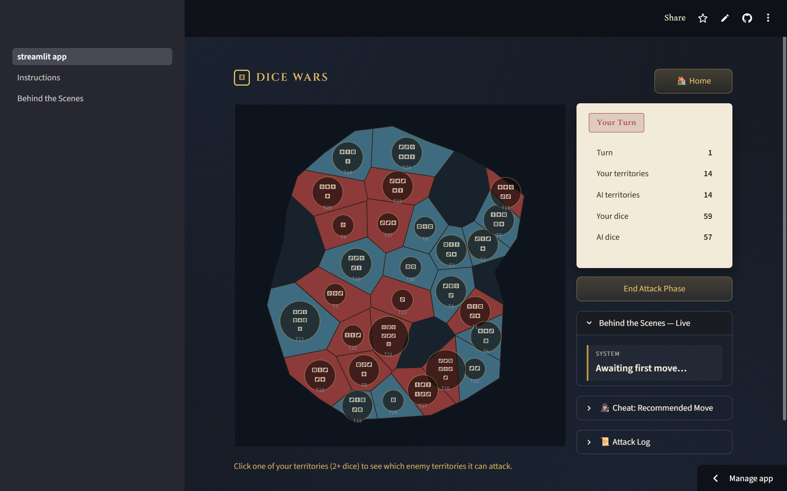

# Dice Wars — Streamlit Edition

A turn-based territory-control dice game where you play against a
**multi-agent AI opponent**, built with Streamlit and Plotly. The AI is a
hierarchical pipeline of three cooperating agents (Strategy → Attack →
Defense), and a fourth agent (the Oracle) can advise you on your best move.
Every AI decision is shown in a live "Behind the Scenes" reasoning feed.

Applied Artificial Intelligence (AAI) course project 



---

## Contents

- [Features](#features)
- [Quick start](#quick-start)
- [How to play](#how-to-play)
- [The AI](#the-ai)
- [Project structure](#project-structure)
- [Maps](#maps)
- [Deploy on Streamlit Community Cloud](#deploy-on-streamlit-community-cloud)
- [Design notes](#design-notes)

More detail: [docs/ARCHITECTURE.md](docs/ARCHITECTURE.md) — system design,
turn flow, agent algorithms, and engine API.

---

## Features

- **Click-to-attack board** — organic Voronoi-style territories drawn with
  Plotly; click your territory, then click a highlighted enemy neighbour.
- **Three map sizes** — Skirmish Isle (18 territories), Twin Peninsulas (28),
  Grand Continent (40), each with 4 pre-generated layout variants.
- **Multi-agent AI opponent** — Strategy, Attack and Defense agents working
  as one pipeline, using Monte Carlo win-probability estimates.
- **Oracle "cheat" panel** — a fourth agent that ranks your best attacks,
  accounting for counter-attack exposure.
- **Live reasoning feed** — every agent decision appears with a headline and
  a short explanation.
- **Animated battles** — every dice battle (yours and the AI's) pops up as a
  centered dice-roll overlay.
- **Instructions** and **Behind the Scenes** pages in the sidebar.

## Quick start

**Requires Python 3.10+** (`game/engine.py` uses `int | None` union syntax).

```bash
pip install -r requirements.txt
streamlit run streamlit_app.py
```

Opens at `http://localhost:8501`. Pick a map on the home screen to start a
match. The **Instructions** and **Behind the Scenes** pages appear
automatically in the sidebar (anything in `pages/` becomes a nav entry).

Runtime dependencies are only `streamlit` and `plotly`
([requirements.txt](requirements.txt)).

## How to play

**Goal:** capture every territory on the map. You are red, the AI is blue.

**Setup.** Territories are split randomly 50/50 between you and the AI. Each
starts with 1–3 dice, then each side gets a bonus of 2 dice per territory
scattered randomly. No territory can hold more than **8 dice**.

**Your turn has two phases:**

1. **Attack phase** — attack as many times as you like.
   - Click one of your territories with **2 or more dice** to select it. Its
     attackable enemy neighbours light up.
   - Click a highlighted enemy territory to attack.
   - Both sides roll all their dice. The attacker wins only if their total is
     **strictly higher** (ties go to the defender).
   - **Win:** you capture the territory and all but one of your dice move in.
   - **Lose:** your attacking territory drops to 1 die.
   - Click **End Attack Phase** when you're done.
2. **Reinforcement phase** — you receive dice equal to the size of your
   **largest connected group** of territories (minimum 1). Place them one at a
   time, or click **Auto-place rest** to put them on your weakest border
   territories.

Then the AI plays its whole turn, battle by battle, and the next round starts.
The game ends when one side owns no territories.

**Tip:** keeping your territories connected is what earns reinforcements.
Open **Cheat: Recommended Move** in the side panel to see what the Oracle
would do.

## The AI

| Agent | Plays for | Role |
|---|---|---|
| **Strategy** ([agents/strategy_agent.py](agents/strategy_agent.py)) | AI | Reads the board once per turn and picks a posture: `EXPAND`, `TARGET_WEAK`, `CONSOLIDATE` or `DEFEND`. |
| **Attack** ([agents/attack_agent.py](agents/attack_agent.py)) | AI | Scores every legal attack with a Monte Carlo win probability and executes the best ones allowed by the posture. |
| **Defense** ([agents/defense_agent.py](agents/defense_agent.py)) | AI | Places reinforcement dice one at a time on the most threatened border territory. |
| **Oracle** ([agents/oracle_agent.py](agents/oracle_agent.py)) | Human (advisor) | Ranks your top 3 attacks by win chance, new frontier gained, and counter-attack exposure. |

[agents/ai_controller.py](agents/ai_controller.py) chains the first three
into one turn. Every agent returns an `AgentThought` (headline + reasoning +
raw data), which powers the live feed. Thresholds and formulas are in
[docs/ARCHITECTURE.md](docs/ARCHITECTURE.md#agents).

## Project structure

```
dicewars_streamlit/
├── streamlit_app.py        # Main page: map select, game board, turn flow, session state
├── pages/
│   ├── 1_Instructions.py   # Rules page
│   └── 2_Behind_the_Scenes.py  # Explains the multi-agent architecture
├── game/
│   ├── engine.py           # Pure game logic: GameState, combat, reinforcement, win check
│   └── data/*.json         # Pre-generated maps (3 sizes x 4 variants)
├── agents/
│   ├── base_agent.py       # BaseAgent + AgentThought dataclass
│   ├── ai_controller.py    # Runs Strategy -> Attack -> Defense for one AI turn
│   ├── strategy_agent.py
│   ├── attack_agent.py
│   ├── defense_agent.py
│   └── oracle_agent.py     # Move advisor for the human
├── board_renderer.py       # Builds the Plotly board figure from game state
├── animation.py            # Battle / reinforcement popups and feed HTML
├── theme.py                # CSS injection and header branding
├── generate_maps.py        # Offline map generator (dev only)
├── requirements.txt        # Runtime: streamlit, plotly
└── requirements-dev.txt    # Map generation: numpy, scipy, shapely
```

## Maps

Each map size has several pre-generated **variants** —
`game/data/<map_id>_a.json` through `_d.json` — each with its own randomized
coastline, seed scatter, and pattern of interior "holes" (cells left out so the
board has lake-like gaps instead of tiling edge-to-edge). `GameState.__init__`
picks a variant at random using the match's own seed, so a match is fully
reproducible from that seed.

Territory *count* is always exactly the size's target (18 / 28 / 40): holes are
carved only after over-generating territories, and a cell is removed only if
the rest stays one connected landmass (checked with a BFS after every
candidate removal).

To regenerate or add variants:

```bash
pip install -r requirements-dev.txt
python generate_maps.py
```

Because maps are checked in as JSON, scipy/Shapely are **not** needed to run
or deploy the app.

## Deploy on Streamlit Community Cloud

1. Push this folder to a GitHub repo (repo root = this folder, so
   `streamlit_app.py` sits at the root).
2. Go to [share.streamlit.io](https://share.streamlit.io) → sign in with
   GitHub → **New app**.
3. Pick your repo/branch, set **Main file path** to `streamlit_app.py`.
4. Click **Deploy**. No build command or process config is needed.

You'll get a URL like `https://<something>.streamlit.app`.

## Design notes

This is a Streamlit rebuild of an earlier Flask/Canvas version. The game
engine and all agents are unchanged pure Python; only the presentation layer
and map generator were reworked.

| Flask/Canvas version | Streamlit version | Why |
|---|---|---|
| Flask-SocketIO WebSocket push | Plain Streamlit reruns + `st.session_state` | Streamlit has no persistent WebSocket event model to hook into |
| CSS keyframe dice-tumble animation | A `.dw-overlay-backdrop` / `.dw-overlay-modal` placeholder updated in a loop with `time.sleep` between frames | No custom JS in a stock Streamlit deploy; this reproduces "tumble then reveal" with only Python + CSS |
| Live-streaming agent reasoning feed | Same feed, revealed step-by-step *within one script run* | Streamlit can't push from server to client outside a script execution, but updating a placeholder in a loop still animates |
| Canvas click-to-attack | Click-to-attack via Plotly's `on_select` event on a marker trace | Streamlit 1.3x+ has first-party click-selection events for Plotly charts |
| gunicorn + eventlet, in-memory `GAMES` dict keyed by session | `st.session_state` | Streamlit handles per-session isolation itself |

**AI turn timing.** Because Streamlit reruns the whole script on each
interaction, the AI's full turn (goal → attacks → reinforcement) runs
synchronously inside one script execution and reveals itself step-by-step via
placeholders: each capture shows the same battle popup the human's attacks
use, then the board redraws, before the next step. Unlike the Socket.IO
version, nothing is pushed from a background process — the same script
computes and displays the turn.
